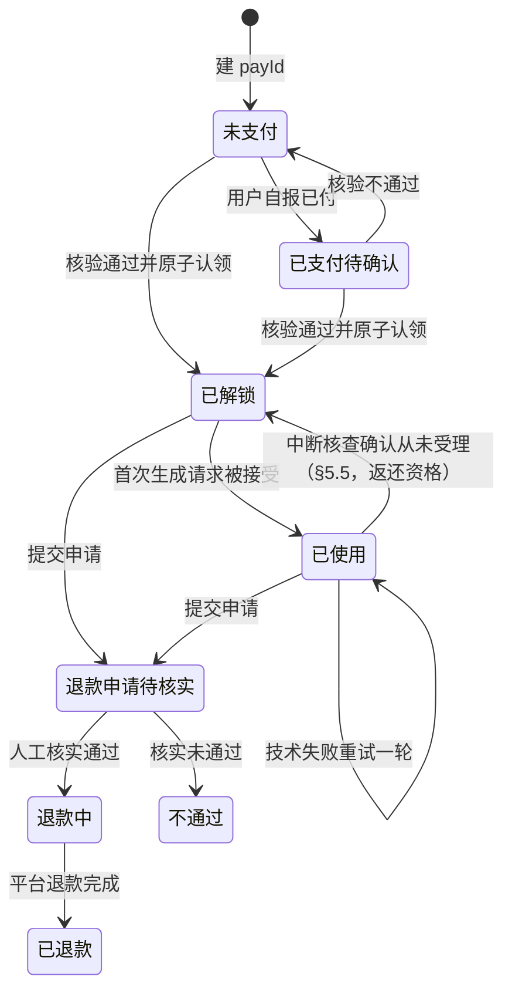
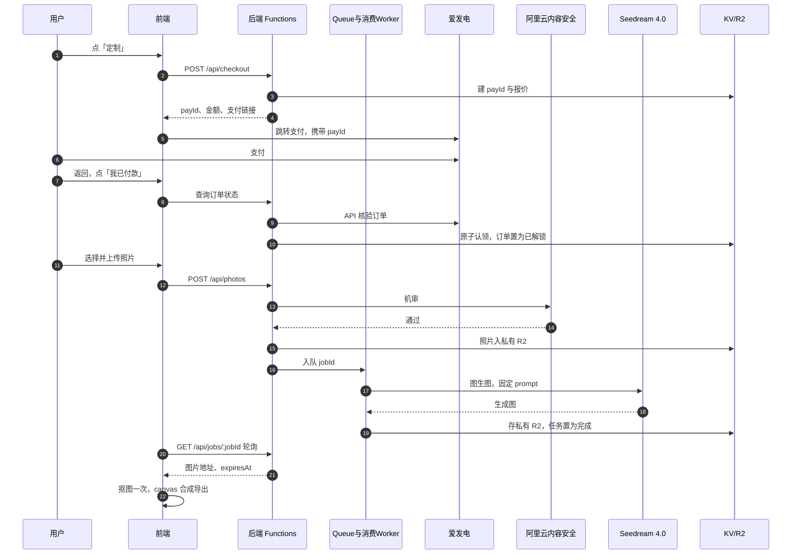
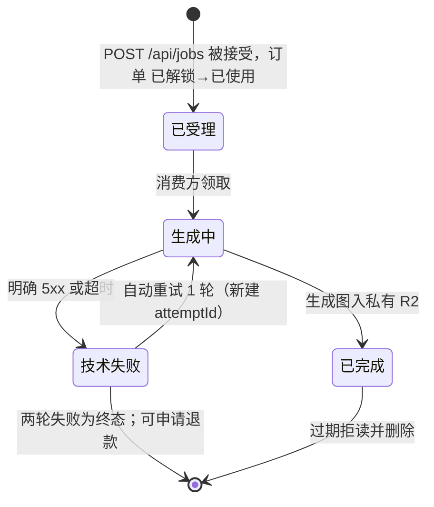

# PETI 支付生图链路 PRD（万圣节活动）

版本 v1.3 ｜ 2026-10-28 ｜ 读者：开发。
范围：付费墙 → 爱发电支付与订单核验 → 照片上传与审核 → 生图任务 → 后处理与双导出保存 → 评分与退款。
问答模块见 `doc/PRD-quiz.md`（定稿 v1.2）；token 口令、session/result 记录、错误码口径以该文 §7 为准。路径均相对项目根目录，上游定稿不复制进本文。

| 状态 | 评审记录 |
|---|---|
| 已修订 | 2026-10-26 首稿 v1.0；2026-10-28 按 quiz MVP 现状重写为 v1.1 |
|  | 2026-10-28 ｜ plan-critic-general（PM 视角）｜ 1 KILL / 5 MODIFY / 8 OPEN ｜ doc/reviews/PRD-payment-generation-plan-critic-general-20261028-r1.md ｜ 已修订 |
|  | 2026-10-28 ｜ plan-critic-general（PM 视角，第二轮）｜ 9 MODIFY / 4 OPEN ｜ doc/reviews/PRD-payment-generation-plan-critic-general-20261028-r2.md ｜ 已修订 |

| 文档 | 本文引用的部分 |
|---|---|
| `doc/quiz-design.md` §6 | 生图 prompt：统一前缀 + 16 角色段 |
| `doc/quiz-design-dog.md` §3 | 狗狗版 prompt 前缀改动 |
| `doc/interaction-design.md` | §2 付费绑定与找回、§3 上传与生成、§4 异常兜底矩阵、§5 导出与分享、§6 埋点 |
| `doc/technical-notes.md` | §4 接口约定、§5 上传兼容、§6 抠图选型与导出、§9 供应商费用 |
| `doc/PRD-quiz.md` §7、§9 | 会话/结果/找回接口与 KV 记录口径；视觉基调与装饰色 |
| `doc/posthog-proxy-setup.md` | PostHog 同域反代部署 |

| 素材 | 内容 |
|---|---|
| `halloween-cat-showcase-card-3x4.png` | 付费角色卡视觉参照（3:4 showcase） |
| `card-free.png`、`free-pic/` | 免费卡立绘（问答模块已用；生产中） |
| 用户上传照片 | 运行时输入，不入素材库 |

## 1. 已锁定决策

| 项 | 结论 |
|---|---|
| 定价 | 早鸟 2 元，截止北京时间 2026-10-31 00:00；之后 5.9 元；金额分值 200 / 590 |
| 生成数量 | 每单 1 张；仅技术失败自动重试 1 轮；不人工补生 |
| 评分退款 | 用户 1–5 分、可跳过；1–2 分出退款申请入口；24 小时内核实，不承诺到账 |
| 档位一致 | 两档同清晰度、同水印；无早鸟角标 |
| 供应商 | 收款：爱发电。审核：阿里云内容安全。生图：火山方舟 Seedream 4.0 图生图。部署：Cloudflare Pages + KV + R2。供应商选择已锁定；6% 费率、0.005/0.2 元单价与留存条款均沿用预算、未经真单核实，核实截止 10-28（见 §12.5） |
| 成本 | 生图两轮约 0.4 元/单；不含审核、抠图与云资源 |
| 人工通道 | 爱发电私信（作者唯一可核验付款身份的渠道）；上线期每日 10:00–24:00 内响应，10-31 19:00–22:00 实时值守 |
| 前置依赖 | 宠物名在落地页命名（quiz MVP 已实现），结果记录已含 petName；付费链路直接取用，不再设命名步骤 |
| 卡面口径 | 卡面 = 生成形象 + canvas 重建文字层（同免费卡口径）；公开编号不上卡（2026-10-27 UI 改版裁决） |
| 上线门槛 | 收费上线前五项必须验通（验证动作与 10-28 清单同表，见 §10.3）：①爱发电真实订单核验 + 退款实操真单 + 留言可读性；②内容安全审核；③Seedream 生图（猫、狗样图各 1）+ 供应商任务状态查询能力；④Queue 启用或 §5.5 中断补偿联调通过；⑤小红书 webview 真机回流与凭证复制恢复。任一未验通，只上线免费测评 |

## 2. 价格与倒计时

1. 唯一截止点：`2026-10-31T00:00:00+08:00`，即 UTC `2026-10-30T16:00:00Z`。
2. 前端从 GET /api/config 取 serverNow、cutoffAt、amountFen，按服务器时间校准时钟。
3. 倒计时显示「总小时:分:秒」；小时可超过 99，不按天取模。
4. 到 0 后隐藏倒计时、价格改 5.9 元，不重置。
5. 回到前台重新取价；跳转支付前以 checkout 返回的 amountFen 为准。
6. 最终收费由后端判定；前端倒计时只是展示。
7. 平台侧切换：爱发电同商品建双方案（早鸟 2 元 / 标准 5.9 元）；checkout 按截止点返回对应方案链接，核验按方案与金额匹配。00:00 下架早鸟方案为人工动作，作者 10-31 23:45–次日 00:15 待命执行；未及时下架产生的 2 元付款按 §3.4.3 标异常人工退款。

## 3. 支付流程

### 3.1 发起

1. 用户在结果页点「定制我家猫 / 定制我家狗」（按 petType）才打开付费墙；未解锁禁止上传。
2. POST /api/checkout：服务端建 payId，绑定 testId、角色、金额。
3. 跳转爱发电优先携带 `custom_order_id=payId`；不可透传时引导复制 payId 填入订单留言（留言能否被 API 读回自动认领，10-28 随门槛①验证）；两者都不可用时，核对失败页提供平台订单号手填入口，后端凭订单号核验。
4. 跳出前展示：金额、支付标识（payId）、找回凭证；提示「付款后返回本页点『我已付款』，请勿重复付款」。
5. 本期不依赖自动回跳与回调。

### 3.2 查单与频控

1. 回页立即查一次。
2. 前台每 5 秒读本站状态；满 2 分钟改每 15 秒；满 10 分钟暂停自动查询。
3. 服务端全站最多每 15 秒拉一次平台订单，缓存并合并请求；平台限制更严时从严。
4. 「我已付款」按钮冷却 15 秒；单 payId 每分钟最多 4 次，不能绕过全站频控。

### 3.3 认单规则

1. 后端核验五项：交易成功、收款主体、商品/方案、实付金额、与 payId 的对应关系。
2. 禁止凭截图、买家昵称或前端「已付款」状态解锁。
3. 平台订单号全局只能认领一次；认领用条件写（§9.3.1）。
4. 每个结果同时最多一个未完成 payId（未完成 = unpaid / verifying / unlocked）；已使用或退款终态订单可再次 checkout 购买新一轮生成（新 payId、独立两轮额度）。每单只发一份权益。
5. 重复确认返回原 ID 与原权益；同 payId 多笔付款标记重复款，人工退多付。
6. 金额或商品不符：提示「订单信息暂未匹配，请勿补付，联系作者核对」；「联系作者」入口见 §1 人工通道。

### 3.4 跨期处理

1. 早鸟报价到截止点失效；未付订单跨期须用户确认 5.9 元新价后重新 checkout，不静默改价。
2. 截止前支付成功的 2 元订单，之后才核验也可领取。
3. 截止后旧链接仍付 2 元：标异常、人工核实后退款；不补扣差价，不假解锁。
4. 支付时间以平台真实字段为准；缺字段转人工，不用查询时间代替。

### 3.5 订单状态机

1. 「已支付待确认」只展示「正在核对付款」，不授予权益。
2. 「退款申请待核实」期间暂停新生图。

### 3.6 找回凭证

1. 本浏览器：结果与订单自动归档浏览器历史，首页自动恢复（quiz MVP 已实现的主路径）。
2. 换浏览器或备用域名：凭恢复链接恢复；128 位口令由链接 fragment 携带。恢复分两步：`/api/recover` 取回结果（PRD-quiz §7.7），`GET /api/checkout/current` 取回订单状态（本文 §9.2）——与 `doc/technical-notes.md` §4「recover 出参含订单状态」的口径差异在此接平。付费墙在跳出支付前展示该链接与口令，并建议用户复制保存。
3. 口令与链接不写入公开卡片、支付链接、埋点或 Referer。
4. 主备域名共用 KV/R2。
5. 链接与口令均丢失：走付款账号人工核验（§1 人工通道）。
6. 结果元数据保留 30 天；未交付订单保留至交付或退款。
7. 恢复链接等同生成权凭证：转发即转授权限，无重置口令功能；UI 上恢复链接（仅自己保存）与分享文案（可传播）分区呈现。风险已知并接受。

## 4. 上传与审核

1. 使用系统照片选择器；accept 为 image/*；不强制相机；取消选择保留旧图，不算失败。
2. 格式 JPEG/PNG/WebP；原图 ≤10MB。
3. 客户端压缩：长边 ≤1600px、JPEG ≤2MB；按 EXIF 校正方向并去除元信息。
4. 短边不足 512px 提示换图；HEIC 能解码则转 JPEG，否则提示上传 JPG 或截图。
5. 服务端复验格式、尺寸、大小；审核限流：每口令/IP 每分钟 ≤3 张；换图重审（换图门禁见 §9.2 photos）。
6. 审核通过前禁止生图；拒绝即删暂存照片，不扣生成次数。
7. 分阶段提示「正在读取照片…」「正在上传…」「正在检查照片…」；真机兼容矩阵见 `doc/technical-notes.md` §5。

隐私规则（已锁定）：

1. 隐私勾选默认不勾选；文案全文见 `doc/interaction-design.md` §3，要点不得删改：仅用于本次审核与生成、不用于训练、7 天删除、勿传人脸证件。
2. 照片仅发送阿里云内容安全与火山方舟。
3. R2 全程私有；到期接口拒绝读取。
4. 删除 = 接口到期拒读 + 后台主动删除并核验 + 生命周期规则兜底。
5. 派生图继承原图到期日；换背景不续期。
6. 残留风险明示：机审只拦违规内容，不拦人脸、证件与他人宠物照；约束靠上传页文案（勿传人脸证件）。本风险已知并接受，首版不加第二道审核。

## 5. 生图任务

### 5.1 链路

1. Queue + 消费 Worker 选型待确认。启用后由消费 Worker 执行生图，关页不影响。
2. 未启用 Queue 期间由 Functions 同步触发；关页、锁屏、切 App 均可能中断请求，中断按 §5.5 处理。收费上线前必须二选一：启用 Queue，或验证 §5.5 补偿可用（§1 上线门槛④）。
3. 队位只按本站待提交任务估算；平台不返回进度时不伪造百分比。

### 5.2 Prompt 与参数

1. 猫版：统一前缀 + 角色段，见 `doc/quiz-design.md` §6，逐字使用。
2. 狗版前缀改动见 `doc/quiz-design-dog.md` §3；角色段与猫版共用。
3. 生成主图 1:1、2048×2048；分辨率给足。
4. 图内不得出现文字；卡面文字全部由前端 canvas 绘制。

### 5.3 轮询、重试与两轮规则

1. 前端每 5 秒查任务；满 2 分钟提示「比平时久一点，可稍后回来」；满 10 分钟停自动查询，保留「查询进度」按钮。
2. 明确 429：按 Retry-After 退避；缺失时按 10/30/60 秒；三次失败转人工。未受理的 429 不占第二轮。
3. 明确 5xx 失败最多补发一次。
4. 受理未知（网络超时）不自动补发；请求总超时 180 秒；后续按 §5.5 核查。
5. 两轮 = 首次 + 技术失败自动重试 1 次；重试沿用 jobId、新建 attemptId、原子扣第二轮额度。
6. 消费幂等：调用前持久化 attemptId；队列重复投递不重复调用、不重复扣次。
7. 抠图、卡片重绘失败只重做对应步骤，不占第二轮，不重新生图。
8. 成功但不像：走评分与退款申请，不再生图。

### 5.4 任务状态机

### 5.5 中断与补偿

1. 「受理未知」= 请求发出后未收到明确成功或失败（超时、断网、关页）。不并发补发；等用户回页查询或服务端核查。
2. 服务端凭 attemptId 向供应商核查任务真实状态（该查询能力为上线门槛③验证项）：
   - 从未受理 → 订单 已使用 回滚 已解锁，job 置 failed-unstarted，返还生成资格；
   - 已受理、无结果 → 沿用 §5.3.1 轮询与文案，任务仍在跑；
   - 供应商终态失败 → 按 §5.3.3 自动重试一轮。
3. 回滚边（已使用 → 已解锁）全库唯一，回滚时写操作日志；已重试过的订单不回滚，转技术失败终态走退款。
4. 用户回页时前端先查任务、后查订单，两态不一致时以服务端核查结果为准。
5. 任务查询能力不可用时，§12.1 缺省改为必须启用 Queue。

## 6. 后处理与导出保存

1. 生成成功后只抠图一次，产出透明主图；抠图位置与模型待确认，候选与许可见 `doc/technical-notes.md` §6。
2. 五色背景 bg-1…bg-5 由前端在透明主图上铺色；不重新调用生图；色值待视觉定稿（缺省见 §12.4）。
3. 导出物规格：

| 导出物 | 规格 | 要点 |
|---|---|---|
| 免费简版卡 | PNG 750×1000 | 问答模块已实现，不在本 PRD 范围 |
| 完整角色卡 | 竖版，比例与尺寸待定（三源冲突记录见 §12.3） | 专属形象、宠物名、角色名、金句、搜索口令、AI 标识 |
| 独立头像 | 1:1，尺寸待定（推荐 1080×1080） | 透明或五色底；圆形裁切预留边距；无卡框姓名 |
| 内部主图 | 1:1、2048×2048 | 生成原图 + 透明主图；不直接对外暴露 |

4. 双导出 = 同一结果导出两种成品，不是生成两次；导出与重复导出不消耗生成次数。
5. 水印与标识：搜索口令「喵灵万圣节」由 canvas 绘制；AI 生成标识保留在所有导出物上；透明、换底后重新核验标识仍在。隐式标识：导出 PNG 时由前端写入元信息（最小集：AI 生成标识、生成时间），canvas 重编码致丢失时以元信息写入兜底；实现方式在技术方案阶段定死。「仅去品牌字」的导出开关待确认，两档同规则。
6. 保存交互：普通浏览器点保存（a[download] + Blob）；微信内置浏览器引导「长按图片保存到相册」。文件名 `喵灵万圣节-{宠物名}-角色卡.png` / `-头像.png`，宠物名过滤路径非法字符；宠物名不做敏感词库，活动期风险已接受。
7. 每次保存给成功反馈；保存失败提示重试，只重绘不重新生图。
8. 渲染用原生 canvas；图片经本站鉴权代理读取，避免 canvas 污染；长宠物名缩字或换行。
9. 派生导出图继承主图 7 天到期日；到期后本站拒绝再导出，提示重新测一份新结果。
10. 分享：成品页提供「复制分享文案」，内容含搜索口令与角色名、不含公开编号（公开编号已随 2026-10-27 UI 改版移除；上游 `doc/interaction-design.md` §5 文案中的编号 {ID} 以本条无编号版为准，口径漂移已记录）。复制成功触发 share_copy。

## 7. 评分与退款

1. 成品页显示「像你家猫吗？请打 1–5 分」；可跳过；不拦下载。
2. 1–2 分显示退款入口；3–5 分保留问题反馈入口。
3. 理由必填：毛色/花纹不符、脸部差异、主体遮挡、背景处理异常、其他。
4. 同订单只保留一条待处理申请；状态：待核实、退款中、已退款、不通过。
5. 提交申请即暂停新生图；确认退款后冻结新的云端领取。
6. 24 小时是核实承诺，不是到账承诺；退款按爱发电账户实际流程操作，本期无自动退款接口。
7. 评分不自动触发退款；不做 AI 相似度评分。

## 8. 异常兜底（必做行）

完整矩阵见 `doc/interaction-design.md` §4，行为以该表为准。开发必须实现以下行：

| 场景 | 系统行为 |
|---|---|
| 支付失败、中断、放弃 | 保留 payId；不占生成次数 |
| 已付未确认 | 只展示核对中；10 分钟后给「联系作者」入口（§1 人工通道） |
| 重复付款 | 一份权益；人工退多付 |
| 审核拒绝 | 阻断生图；不扣次；立即删图 |
| 审核服务故障 | 阻断生图；保留权益 |
| 生图超时、受理不明 | 标不确定；禁止并发补发；按 §5.5 核查补偿 |
| API 配额或余额耗尽 | 已付保留权益；暂停新收费 |
| 两轮技术失败 | 可申请退款；不再生图 |
| 图片过 7 天 | 拒读并已删除；不自动重扣 |

## 9. 接口

出入参以本节为准；`doc/technical-notes.md` §4 只到字段名级，与之冲突时以本节为准。

### 9.1 通用约定

1. 鉴权：POST 一律 body 字段 token；GET 一律请求头 `X-PT-Token`。校验以 `session:{testId}` 记录为准，口径同 `doc/PRD-quiz.md` §7.2。
2. 错误统一 `{ code, message, retryable }`。在 PRD-quiz §7.3 基础上新增：NOT_UNLOCKED（订单未解锁）、ORDER_MISMATCH（订单不匹配）、PAY_ID_STALE（报价过期）、PHOTO_INVALID（复验不过或生成中禁换图）、PHOTO_REJECTED（审核拒绝）、QUOTA_EXCEEDED（配额耗尽）、REFUND_LOCKED（退款期暂停生图）。
3. 价格、角色、任务状态由服务端决定；订单与任务响应不缓存；供应商密钥仅存后端。

### 9.2 接口清单

| 接口 | 入参 | 出参 | 幂等与备注 |
|---|---|---|---|
| GET /api/config | 无 | serverNow、cutoffAt、amountFen | amountFen 按当前时刻算好；前端只展示 |
| POST /api/checkout | token、testId | payId、amountFen、quoteExpiresAt、payUrl | 须已有 completed 结果；存在未完成 payId（§3.3.4 定义）返回原 payId；已使用/终态订单可再次 checkout；payUrl 携带 custom_order_id=payId（验通前降级为留言引导） |
| GET /api/checkout/:payId | 头 X-PT-Token | status、amountFen | status ∈ unpaid / verifying / unlocked / used / refund_pending / refunding / refunded / rejected；不缓存 |
| GET /api/checkout/current | 头 X-PT-Token、query testId | payId、status、amountFen（无订单返回空） | 换浏览器恢复订单状态用（§3.6.2）；不缓存 |
| POST /api/photos | token、testId、multipart 文件 | photoId、reviewStatus | 服务端复验 → 阿里云审核 → 私有 R2；拒绝返回 PHOTO_REJECTED 并删图；换图新 photoId、旧 photoId 即删，但门禁：限订单已解锁且无进行中 job，job 进行中返回 PHOTO_INVALID 且不删图；限流每口令/IP 每分钟 ≤3 张 |
| POST /api/jobs | token、testId、payId、photoId | jobId、stage | 校验照片审核通过、未过期、归属本 testId；同 payId 存在进行中 job（accepted/generating）返回原 jobId，job 已终态新建 jobId；条件写订单 已解锁→已使用（§9.3.1） |
| GET /api/jobs/:jobId | 头 X-PT-Token | stage、imageUrl、expiresAt | stage ∈ accepted / generating / ready / failed；imageUrl 为本站鉴权代理地址；不缓存 |
| PUT /api/jobs/:jobId/rating | token、score（1–5） | score | 可重复提交，保留最后一次 |
| POST /api/refund-requests | token、payId、score、reasonCode | requestId、status=pending | 同 payId 仅一条待处理，重复提交返回原 requestId；reasonCode 取 §7.3 五枚举 |

### 9.3 KV 与 R2 记录

1. 多写者状态（认领、订单状态迁移、扣次、回滚）真源用 R2 条件写：`claims/{platformOrderNo}`（认领凭证，内容 payId）、`orders/{payId}.json`（订单状态机真源，含 tokenHash、testId、petType、roleId、amountFen、platformOrderNo、status、createdAt）。认领、已解锁→已使用、回滚均在这两个对象上条件写完成；并发写失败即竞态失败，重读后重试一次或拒绝。条件写原语（Workers R2 onlyIf / etag）在技术方案核实，不可用时由技术方案给出等价原子方案。
2. KV 为只读副本与索引：`order:{payId}` 供鉴权与查询加速；不一致以 R2 为准。session/result 等单写者记录维持 KV，同 PRD-quiz §7.5 口径。
3. `job:{jobId}`：payId、photoId、attemptId、stage、imageKey、expiresAt、attempts ≤ 2（单写者，KV）。
4. R2 其余：`photos/{testId}/{photoId}`、`jobs/{jobId}/{attemptId}.png`；导出成品由前端合成，不落盘。
5. 生命周期：photos/、jobs/ 图片前缀 7 天到期删除，接口侧先以 expiresAt 拒读；claims/、orders/ 前缀不进生命周期规则，由后台按订单终态清理；不得误删未交付订单凭证。
6. KV 写额：quiz 与订单共用同一账户免费档 1,000 写/日。日活 200 时 quiz 占约 400 写；付费单每单约 6–10 写（checkout 1、photos 1–2、jobs 2、rating/refund 1–2），余量约支撑每日 60 付费单。升 Workers 付费档的决策定为 10-30 放量前置条件（按 10-29 灰度实测推算），不做事后核算。

## 10. 埋点与上线

1. 埋点走 PostHog Cloud + 同域 `/ingest` 反代，同 PRD-quiz §8.1，不自建 /api/events。事件：pay_click、checkout_created、payment_verified（仅一次）、photo_review、generation_end、rating_submit、refund_request、export_ready、share_copy、recovery、error（后两者参数 outcome、stage、code，定义见 `doc/interaction-design.md` §6）。
2. 漏斗目标（上线满 7 日统计，PostHog 漏斗 + 订单台账核验；早鸟/正价、猫/狗分层查看）：点定制 / 看结果 > 15%；实际付款 / 看结果 > 5%；交付率 = 出图成功 / 已付款 ≥ 90%；退款申请率 = 退款申请 / 交付成功 ≤ 10%。
3. 10-28 验通清单（与 §1 上线门槛同表，全绿才收费上线）：①真实订单核验 + 退款实操真单 + 留言可读性；②内容安全；③生图猫、狗样图 + 供应商任务状态查询（故意发一次会超时的请求，确认可凭 attemptId 区分从未受理/进行中/终态失败）；④Queue 或 §5.5 中断补偿联调；⑤小红书 webview 回流与凭证复制恢复。10-29 灰度；10-30 放量；10-31 19:00–22:00 值守、23:45–次日 00:15 待命执行早鸟方案下架；故障时停新收费，保留免费分享。
4. 引流预案：笔记不带外链、只用搜索口令「喵灵万圣节」；若笔记被限流，用评论区置顶与主页签名同步口令，不依赖第二渠道。

## 11. 验收标准

1. 幂等：同 testId 重复 checkout 返回原 payId；二次 checkout（前单已使用）生成新 payId。
2. 并发认领：同 platformOrderNo 并发两次认领仅一次成功，只产生一份权益。
3. 价格：客户端改本地时钟不影响服务端金额判定；跨截止点未付订单须确认新价重新 checkout 后才可付。
4. 频控：「我已付款」冷却 15 秒生效；触发限流返回 429 与 Retry-After。
5. 审核：拒绝照片阻断生图、不扣次、R2 无该照片残留对象。
6. 两轮：首轮明确 5xx 自动重试一次；两轮失败为终态、可申请退款；未受理 429 不占第二轮。
7. 中断补偿：模拟受理未知（超时）后服务端核查确认从未受理，订单回滚 已解锁、job 置 failed-unstarted；回滚仅发生一次；回滚后重新 POST /api/jobs 新建 jobId 成功。
8. 换图门禁：job 进行中换图返回 PHOTO_INVALID 且旧 photoId 未删；已解锁且无进行中 job 时换图成功、旧 photoId 删除。
9. 导出：同一生成结果可重复导出角色卡与头像，不扣次；导出物含水印与显式 AI 生成标识，透明与换底导出后仍在；PNG 元信息含隐式标识最小集。
10. 分享：复制分享文案含搜索口令与角色名、不含公开编号。
11. 找回：换浏览器凭恢复链接两步恢复结果与订单状态；链接口令均丢失走付款账号人工核验。
12. 退款：1–2 分出申请入口；同 payId 第二次提交返回原 requestId；申请期间 POST /api/jobs 返回 REFUND_LOCKED。
13. 到期：expiresAt 后图片接口拒读。
14. 隐私：口令不出现在任何埋点 URL、导出卡片、Referer。

## 12. 待确认项

裁决截止：10-28 验通时；到期未裁按缺省执行，不得各自发挥。

1. Queue 与消费 Worker 是否启用。缺省不启用，前提=供应商任务状态查询验通且 §5.5 联调通过；任务查询不可用 → 改为必须启用 Queue，否则按 §1 门槛不上付费。
2. 抠图执行位置与模型；缺省浏览器端。
3. 完整角色卡比例与尺寸。三源冲突记录：`doc/interaction-design.md` §5 与 `doc/technical-notes.md` §6 推荐 9:16 1080×1920（壁纸+时钟留白），本文参照 3:4 showcase，`doc/quiz-design.md` §6 允许 3:4/1:1。裁决人：作者；缺省 3:4、1080×1440。
4. 五色背景 bg-1…bg-5 色值；缺省由 §13 装饰色四色 + 近黑派生。
5. 供应商费率、单价与留存条款真单核实（爱发电 6% 与退款实操、阿里云 0.005 元/张、Seedream 0.2 元/张）。缺省：退款实操未验通前，付费墙与结果页撤下「可申请退款」承诺，评分仅作反馈收集。
6. 仅去品牌字的导出开关；缺省不提供。
7. 若 10-28 验通滑期，早鸟截止（2026-10-31 00:00）是否顺延；缺省不顺延。

## 13. 视觉风格

1. 付费墙、上传页、生成等待、成品页沿用 `doc/PRD-quiz.md` §9 基调：暖炭黑 #2B2020 → 近黑 #010000 渐变背景 + 暗光噪点；装饰色主紫 #9113B8、深紫 #6B1383、暖棕 #57362D、暖金橙 #FC9B26，可按页面明暗与交互状态调明度。
2. 付费角色卡沿用免费卡视觉语言（渐变底、噪点、紫晕金框，全代码 canvas 绘制），整体参照 `halloween-cat-showcase-card-3x4.png`；主体为 AI 生成形象。
3. 五色换底 bg-1…bg-5 色值待视觉定稿（缺省见 §12.4）。
