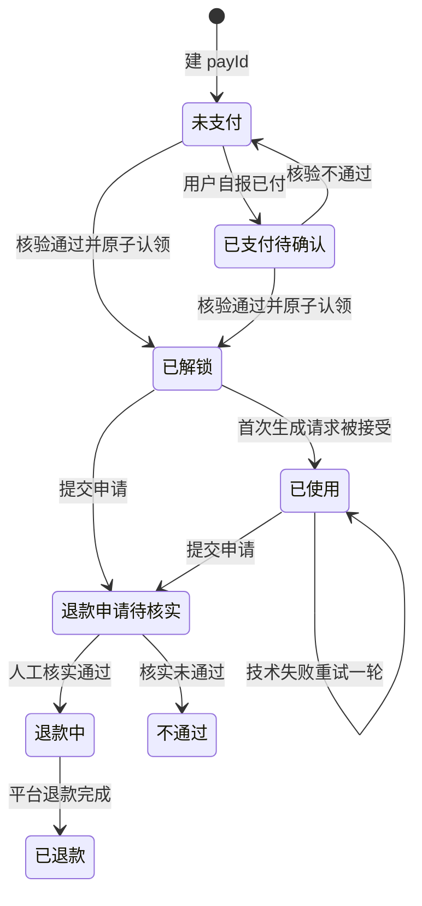
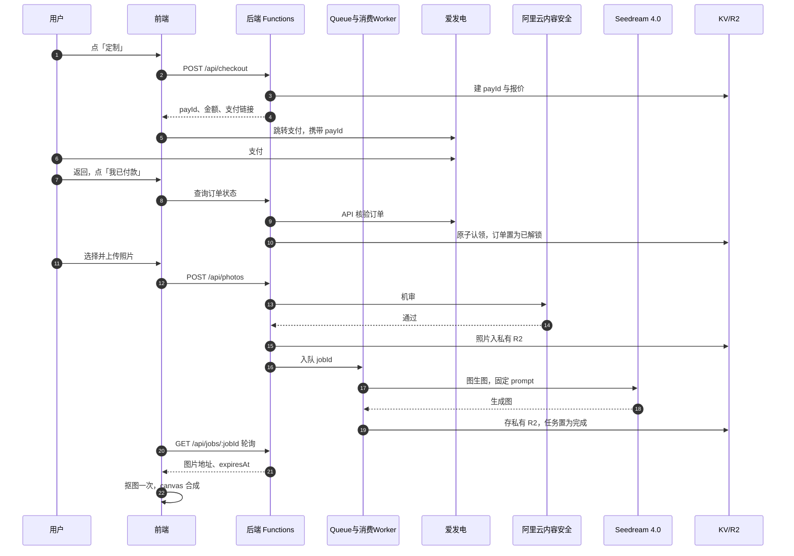

# PETI 支付生图链路 PRD（万圣节活动）

版本 v1.0 ｜ 2026-10-26 ｜ 读者：开发。
范围：付费墙 → 爱发电支付与订单核验 → 照片上传与审核 → 生图任务 → 后处理与双导出 → 评分与退款。
问答模块见 `doc/PRD-quiz.md`。路径均相对项目根目录，上游定稿不复制进本文。

| 状态 | 评审记录 |
|---|---|
| draft | （尚无评审记录） |

| 文档 | 本文引用的部分 |
|---|---|
| `doc/quiz-design.md` §6 | 生图 prompt：统一前缀 + 16 角色段 |
| `doc/quiz-design-dog.md` §3 | 狗狗版 prompt 前缀 |
| `doc/interaction-design.md` | §3 上传与生成、§4 异常兜底矩阵、§5 导出、§6 埋点 |
| `doc/technical-notes.md` | §4 接口约定、§5 上传兼容、§6 抠图选型与导出、§9 供应商费用 |

## 1. 已锁定决策

| 项 | 结论 |
|---|---|
| 定价 | 早鸟 2 元，截止北京时间 2026-10-31 00:00；之后 5.9 元；金额分值 200 / 590 |
| 生成数量 | 每单 1 张；仅技术失败自动重试 1 轮；不人工补生 |
| 评分退款 | 用户 1–5 分、可跳过；1–2 分出退款申请入口；24 小时内核实，不承诺到账 |
| 档位一致 | 两档同清晰度、同水印；无早鸟角标 |
| 供应商 | 收款：爱发电（6%）。审核：阿里云内容安全（约 0.005 元/张）。生图：火山方舟 Seedream 4.0 图生图（约 0.2 元/张）。部署：Cloudflare Pages + KV + R2 |
| 成本 | 生图两轮约 0.4 元/单；不含审核、抠图与云资源 |
| 上线门槛 | 爱发电真实订单未验通前，只上线免费测评 |

## 2. 价格与倒计时

1. 唯一截止点：`2026-10-31T00:00:00+08:00`，即 UTC `2026-10-30T16:00:00Z`。
2. 前端从 GET /api/config 取 serverNow、cutoffAt、amountFen、quoteExpiresAt，按服务器时间校准时钟。
3. 倒计时显示「总小时:分:秒」；小时可超过 99，不按天取模。
4. 到 0 后隐藏倒计时、价格改 5.9 元，不重置。
5. 回到前台与付款前重新取报价。
6. 最终收费由后端判定；前端倒计时只是展示。

## 3. 支付流程

### 3.1 发起

1. 用户在结果页点「定制我家猫」才打开付费墙；未解锁禁止上传。
2. POST /api/checkout：服务端建 payId，绑定 testId、角色、金额。
3. 跳转爱发电优先携带 `custom_order_id=payId`；该参数须真实订单验通后启用；不可透传时引导复制 payId 填入订单留言。
4. 跳出前展示：金额、支付标识、找回凭证；提示「付款后返回本页点『我已付款』，请勿重复付款」。
5. 本期不依赖自动回跳与回调。

### 3.2 查单与频控

1. 回页立即查一次。
2. 前台每 5 秒读本站状态；满 2 分钟改每 15 秒；满 10 分钟暂停自动查询。
3. 服务端全站最多每 15 秒拉一次平台订单，缓存并合并请求；平台限制更严时从严。
4. 「我已付款」按钮冷却 15 秒；单 payId 每分钟最多 4 次，不能绕过全站频控。

### 3.3 认单规则

1. 后端核验五项：交易成功、收款主体、商品/方案、实付金额、与 payId 的对应关系。
2. 禁止凭截图、买家昵称或前端「已付款」状态解锁。
3. 平台订单号全局只能认领一次；认领用条件写（原子操作）。
4. 每个结果同时最多一个未完成 payId；每单只发一份权益。
5. 重复确认返回原 ID 与原权益；同 payId 多笔付款标记重复款，人工退多付。
6. 金额或商品不符：提示「订单信息暂未匹配，请勿补付，联系作者核对」。

### 3.4 跨期处理

1. 早鸟报价到截止点失效；未付订单跨期须用户确认 5.9 元新价，不静默改价。
2. 截止前支付成功的 2 元订单，之后才核验也可领取。
3. 截止后旧链接仍付 2 元：标异常、人工核实后退款；不补扣差价，不假解锁。
4. 支付时间以平台真实字段为准；缺字段转人工，不用查询时间代替。

### 3.5 订单状态机

1. 「已支付待确认」只展示「正在核对付款」，不授予权益。
2. 「退款申请待核实」期间暂停新生图。

### 3.6 找回凭证

1. 凭证 = 恢复链接 + 128 位随机口令；口令由链接 fragment 携带。
2. 口令与链接不写入公开卡片、支付链接、埋点或 Referer。
3. 换浏览器或备用域名凭口令从云端恢复；主备域名共用 KV/R2。
4. 口令与链接均丢失：走付款账号人工核验。
5. 结果元数据保留 30 天；未交付订单保留至交付或退款。

## 4. 上传与审核

1. 使用系统照片选择器；accept 为 image/*；不强制相机；取消选择保留旧图，不算失败。
2. 格式 JPEG/PNG/WebP；原图 ≤10MB。
3. 客户端压缩：长边 ≤1600px、JPEG ≤2MB；按 EXIF 校正方向并去除元信息。
4. 短边不足 512px 提示换图；HEIC 能解码则转 JPEG，否则提示上传 JPG 或截图。
5. 服务端复验格式、尺寸、大小；审核限流：每口令/IP 每分钟 ≤3 张；换图重审。
6. 审核通过前禁止生图；拒绝即删暂存照片，不扣生成次数。
7. 分阶段提示「正在读取照片…」「正在上传…」「正在检查照片…」；真机兼容矩阵见 `doc/technical-notes.md` §5。

隐私规则（已锁定）：

1. 隐私勾选默认不勾选；文案全文见 `doc/interaction-design.md` §3，要点不得删改：仅用于本次审核与生成、不用于训练、7 天删除、勿传人脸证件。
2. 照片仅发送阿里云内容安全与火山方舟。
3. R2 全程私有；到期接口拒绝读取。
4. 删除 = 接口到期拒读 + 后台主动删除并核验 + 生命周期规则兜底。
5. 派生图继承原图到期日；换背景不续期。

## 5. 生图任务

### 5.1 链路

1. Queue + 消费 Worker 选型待确认；未启用前关页即中断，不得向用户承诺后台完成。
2. 队位只按本站待提交任务估算；平台不返回进度时不伪造百分比。

### 5.2 Prompt 与参数

1. 猫版：统一前缀 + 角色段，见 `doc/quiz-design.md` §6，逐字使用。
2. 狗版前缀见 `doc/quiz-design-dog.md` §3；角色段与猫版共用，替换后使用。
3. 生成主图 1:1、2048×2048；分辨率给足。
4. 图内不得出现文字；卡面文字全部由前端 canvas 绘制。

### 5.3 轮询、重试与两轮规则

1. 前端每 5 秒查任务；满 2 分钟提示「比平时久一点，可稍后回来」；满 10 分钟停自动查询，保留「查询进度」按钮。
2. 明确 429：按 Retry-After 退避；缺失时按 10/30/60 秒；三次失败转人工。未受理的 429 不占第二轮。
3. 明确 5xx 失败最多补发一次。
4. 受理未知（网络超时）不自动补发；请求总超时 180 秒。
5. 两轮 = 首次 + 技术失败自动重试 1 次；重试沿用 jobId、新建 attemptId、原子扣第二轮额度。
6. 消费幂等：调用前持久化 attemptId；队列重复投递不重复调用、不重复扣次。
7. 抠图、卡片重绘失败只重做对应步骤，不占第二轮，不重新生图。
8. 成功但不像：走评分与退款申请，不再生图。

## 6. 后处理与导出

1. 生成成功后只抠图一次，产出透明主图；抠图位置与模型待确认，候选与许可见 `doc/technical-notes.md` §6。
2. 五色背景 bg-1…bg-5 由前端在透明主图上铺色；不重新调用生图；色值待视觉定稿。
3. 导出物规格：

| 导出物 | 规格 | 要点 |
|---|---|---|
| 免费简版卡 | PNG | 通用立绘；标「角色示意」 |
| 完整角色卡 | 推荐 9:16、1080×1920，尺寸待定 | 专属形象、宠物名、ID、金句；顶部留时钟区 |
| 独立头像 | 推荐 1:1、1080×1080，尺寸待定 | 透明或五色底；圆形裁切预留边距 |
| 内部主图 | 1:1、2048×2048 | 生成原图 + 透明主图；不直接对外暴露 |

4. 双导出 = 同一结果导出两种成品，不是生成两次；导出不消耗生成次数。
5. 水印：两档同规则；不做模型去水印；品牌字显隐开关待确认。
6. AI 显式标识与必要隐式标识保留在所有导出物上；透明、换底后重新核验标识仍在。
7. 渲染用原生 canvas；图片经本站鉴权读取，避免 canvas 污染；渲染失败只重绘。
8. 微信内保存引导「长按图片保存」。

## 7. 评分与退款

1. 成品页显示「像你家猫吗？请打 1–5 分」；可跳过；不拦下载。
2. 1–2 分显示退款入口；3–5 分保留问题反馈入口。
3. 理由必填：毛色/花纹不符、脸部差异、主体遮挡、背景处理异常、其他。
4. 同订单只保留一条待处理申请；状态：待核实、退款中、已退款、不通过。
5. 提交申请即暂停新生图；确认退款后冻结新的云端领取。
6. 24 小时是核实承诺，不是到账承诺；退款按爱发电账户实际流程操作，本期无自动退款接口。
7. 评分不自动触发退款；不做 AI 相似度评分。

## 8. 异常兜底（必做行）

完整矩阵见 `doc/interaction-design.md` §4，行为以该表为准。开发必须实现以下行：

| 场景 | 系统行为 |
|---|---|
| 支付失败、中断、放弃 | 保留 payId；不占生成次数 |
| 已付未确认 | 只展示核对中；10 分钟后给人工入口 |
| 重复付款 | 一份权益；人工退多付 |
| 审核拒绝 | 阻断生图；不扣次；立即删图 |
| 审核服务故障 | 阻断生图；保留权益 |
| 生图超时、受理不明 | 标不确定；禁止并发补发 |
| API 配额或余额耗尽 | 已付保留权益；暂停新收费 |
| 两轮技术失败 | 可申请退款；不再生图 |
| 图片过 7 天 | 拒读并已删除；不自动重扣 |

## 9. 接口约束

1. 接口清单与字段见 `doc/technical-notes.md` §4。
2. 结果、订单、任务接口一律校验口令。
3. 价格、角色、剩余次数、任务状态由服务端决定；不采信前端输入。
4. 订单与任务响应不缓存。
5. 供应商密钥仅存后端，不进前端包。
6. 错误统一返回 code、message、retryable；前端按错误码分支。

## 10. 埋点与上线

1. 事件：pay_click、checkout_created、payment_verified（仅一次）、photo_review、generation_end、rating_submit、refund_request、export_ready、share_copy；定义见 `doc/interaction-design.md` §6。
2. 漏斗目标：点定制 / 看结果 > 15%；实际付款 / 看结果 > 5%。
3. 排期：10-27 验通真实支付、审核、生图；10-29 灰度；10-30 放量。
4. 10-31 19:00–22:00 值守；故障时停新收费，保留免费分享。
5. 验收项：双击幂等、跨浏览器找回、审核拒绝、关页恢复、双导出、七天删除、跨截止付款处理。

## 11. 待确认项

以下未定，不得按已选定实现：

1. Queue 与消费 Worker 是否启用。
2. 抠图执行位置与模型。
3. 完整角色卡与头像最终尺寸。
4. 五色背景色值。
5. 仅去品牌字的导出开关。

## 12. 视觉风格

（留空，另行补充。）
