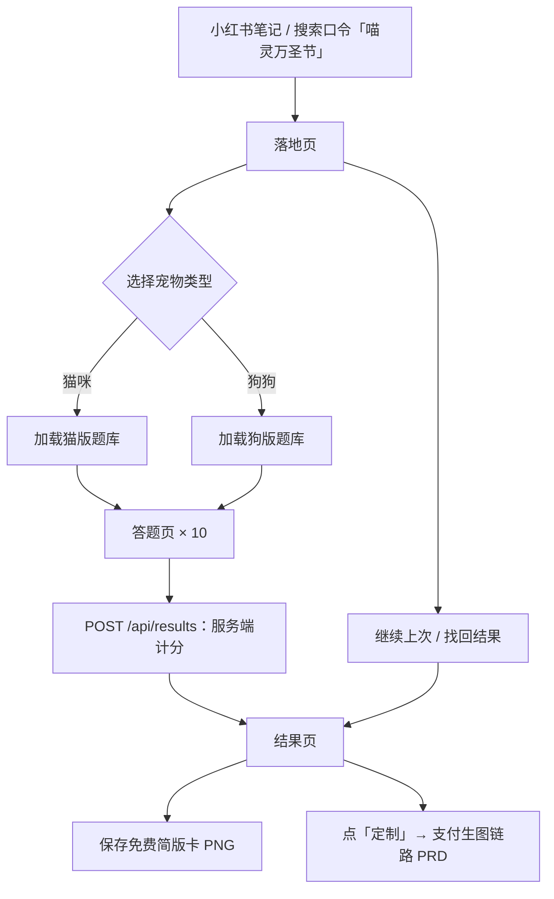

# PETI 问答模块 PRD（万圣节活动）

版本 v1.2 ｜ 2026-10-27 ｜ 读者：开发。
本文路径均相对项目根目录。上游定稿文档不复制进本文，按地址查阅。

| 状态 | 评审记录 |
|---|---|
|  | 2026-10-26 ｜ dev-review ｜ 9 MODIFY / 7 KEEP / 2 OPEN ｜ doc/reviews/PRD-quiz-dev-review-20261026.md ｜ 已修订 |
| 定稿 | 2026-10-27 ｜ dev-review ｜ 7 MODIFY / 2 OPEN，需再修 ｜ doc/reviews/PRD-quiz-dev-review-20261027.md ｜ 已修订 |

| 文档 | 内容 |
|---|---|
| `doc/quiz-design.md` | 10 题、选项加分、16 角色、平衡占比、生图 prompt |
| `doc/quiz-design-dog.md` | 狗狗版文案、角色名后缀、实现注意 |
| `doc/interaction-design.md` | 交互规格 v1.1：页面、存储分工、埋点 |
| `doc/technical-notes.md` | 存储选型、接口约定 |
| `doc/posthog-proxy-setup.md` | PostHog 同域反代部署步骤 |
| `doc/balance-check.py` | 平衡自检脚本；平局顺序以其 TIE_BREAK 常量为准 |

| 素材 | 内容 |
|---|---|
| `page头图.png` | H5 落地页头图，当前为占位、后续更换；现图为剪纸风海报 |
| `card-free.png` | 免费简版卡立绘占位图；猫版形象、全角色共用（狗版同用），标「角色示意」 |

## 1. 范围

1. 覆盖：进入 → 答题 → 出结果 → 保存免费简版卡。
2. 不含：付费、上传、生图。见 `doc/PRD-payment-generation.md`。
3. 免费、无登录。本模块可先行开发上线，不依赖支付链路。

## 2. 已锁定决策

| 项 | 结论 |
|---|---|
| 题量 | 10 题，每题 4 选项，单选 |
| 角色 | 16 个；id、文案、生图 prompt 见 `doc/quiz-design.md` |
| 属性轴 | 电量、贴贴、胆量、戏精、干饭、好奇；仅结果展示，不参与匹配 |
| 匹配算法 | 选项直接给角色加分：签名选项 +3、主 +2、副 +1；总分最高者胜 |
| 平局 | 按固定顺序数组取先；数组以 `balance-check.py` 的 TIE_BREAK 常量为准（题库 JSON 化后随 JSON 维护） |
| 结果计算 | 服务端按 optionId 计分，返回 roleId、六轴、publicId；前端不自行判定 |
| 双入口 | 落地页选「猫咪 / 狗狗」；仓鼠为二期，首版不做 |
| 公开 ID | 仅展示与分享用，不能作订单领取凭证 |

## 3. 答题规则

1. 进入时调 POST /api/sessions，取得 testId 与私密口令；口令存 localStorage。
2. 每题 4 个选项随机排序一次后展示；本次作答内顺序不变。
3. 刷新、返回上一题保持原顺序；题目顺序固定。
4. 答案按 optionId 记录，不按位置记录。
5. 未选答案时禁用「下一题」；末题按钮文字为「揭晓身份」。
6. 每答一题保存一次进度到 localStorage；答完提交服务端。
7. 六轴分 = clamp(5 + 该轴累计增减, 0, 10)。
8. 结果页无翻牌、粒子等装饰动画；保留加载反馈；按钮 ≥44px。

## 4. 页面流程

| 页面 | 关键行为 | 空态去向 |
|---|---|---|
| 落地页 | 头图用 `page头图.png`；记录渠道；开始时建会话 | — |
| 答题页 | 题干、进度、四选一、上一题/下一题 | 结果丢失回首页 |
| 结果页 | 展示结果；导出与付费入口 | 回「找回结果」 |

1. 各页加载中显示「正在加载…」并禁用提交；出错显示「加载失败，请重试」，保留已输入内容。
2. localStorage 存：匿名 ID、渠道、testId、题目版本、选项顺序、答案、宠物名、结果、口令。
3. KV 存：验算结果、公开 ID、口令哈希。
4. localStorage 不作为任何权益依据。
5. 找回失败统一提示「口令无效或已超过保留期」，保留输入并回落地页，不泄露结果是否存在。

## 5. 结果页

1. 展示：角色立绘、称号、六边形雷达图、3 条短句、金句、宠物名、公开 ID。
2. 宠物名限 1–12 字（按 Unicode 码点计，前后端同口径）；默认名猫「我家猫」、狗「我家狗」。改名只触发重绘。
3. 「再测一只」新建 testId；不覆盖旧结果与旧订单。
4. 稀有度文案展示「全站仅 X% 的毛孩子是这个角色」；X 取 `doc/quiz-design.md` §7 占比数据。
5. 免费简版卡：canvas 导出 PNG；立绘用占位图 `card-free.png`（全角色共用、标「角色示意」；16 角色生产立绘为上线前待办）、角色名、宠物名、公开 ID、金句、搜索口令「喵灵万圣节」。

## 6. 双入口差异

1. 题库数据分文件 `quiz-cat.json` / `quiz-dog.json`，JSON 为唯一数据源：题干、optionId 命名、选项加分、TIE_BREAK 平局顺序、16 角色、结果文案、默认宠物名全在其中；前端展示与服务端计分读同一份。两份 JSON 归产品实现仓库维护，`balance-check.py` 随迁做校验（直接读 JSON，不再另抄加分表）；本仓库以 `doc/quiz-design.md`、`doc/quiz-design-dog.md` 为其内容上游。
2. 改动规则：只改文案 → 改 JSON 后重跑 `balance-check.py`；动选项、加分或题量 → 重跑校验并升 quizVersion（如 `cat-2026v2`），旧会话答案不跨版本解释。
3. 角色名 = 基础名 + 后缀：咪 / 汪；「本咪 / 本汪」类文案按类型各存一份。
4. 狗版生图前缀见 `doc/quiz-design-dog.md` §3。

## 7. 接口

出入参以本节为准；`doc/technical-notes.md` §4 只到字段名级，与之冲突时以本节为准。

1. POST /api/sessions：入参 source、quizVersion、petType → 出参 testId（随机生成、不可枚举）、token（即私密口令，128 位随机），成功即写入 session 记录。quizVersion 取值 `cat-2026v1` / `dog-2026v1` 且须与 petType 匹配，不匹配归 PARAM_MISSING；petType 取 `cat` / `dog`。不幂等，每次进入新建会话；按 IP 限创建频率，限流用实例内存近似、不占 KV 写额。
2. POST /api/results：入参 token、testId、optionIds（10 个）、petName → 出参 roleId、六轴、publicId、结果文案（按 petType 出咪/汪后缀版）。token 走 body 字段；token 校验与 petType、quizVersion 取值均以 session 记录为准，不采信前端。幂等：同 token+testId 重复提交（含双击、超时重试）返回原结果原 publicId，`result:{testId}` 键 put-if-absent 实现，completed 为终态不回退。
3. 错误统一 `{ code, message, retryable }`，错误码至少含 TOKEN_INVALID、PARAM_MISSING、PET_NAME_TOO_LONG、RATE_LIMITED、SERVER_ERROR。petName 服务端校验 1–12 字（按 Unicode 码点计，与前端同口径）；角色判定只发生在服务端。
4. 术语：本文「私密口令」= technical-notes「私密凭证」= interaction-design「找回凭证」，同物定一名。
5. KV 两类记录：`session:{testId}` 含口令哈希、petType、quizVersion、source、createdAt，expirationTtl 30 天，token 校验与 petType/quizVersion 来源以此为准；`result:{testId}` 含 testId、petType、quizVersion、optionIds、petName、roleId、六轴、publicId、口令哈希、createdAt、status（取值 answering / completed，completed 为终态），expirationTtl 30 天。publicId 用 8–10 字符随机直接写入，活动量级碰撞概率可忽略；不建 publicId 反查索引（找回凭口令）。
6. KV 额度：免费档写入 1,000 次/日，每用户至少 2 写（会话＋结果），约数百日活即触顶。上线前按账户实际配额核算，超限预案：升 Workers 付费档按量计费。
7. POST /api/recover（找回结果）：入参 token、testId → 出参原结果，失败按 §4.5 统一文案；鉴权口径同 results，字段名级定义见 `doc/technical-notes.md` §4。

## 8. 埋点与验收

1. 埋点：PostHog Cloud SDK 直发，经同域 `/ingest` 反代转发，不自建 /api/events。事件五个：landing_view、quiz_start、quiz_answer、quiz_complete、result_view，定义见 `doc/interaction-design.md` §6，反代部署见 `doc/posthog-proxy-setup.md`。
2. 漏斗目标：完成数 / 开始数 > 60%，PostHog 漏斗看板核验。
3. 验收标准见 §10。

## 9. 视觉风格

1. 基调：万圣节元素 + 剪纸叠层场景；落地页头图 `page头图.png` 现图为占位、后续更换，风格同此基调。
2. 答题区背景：暖炭黑 #2B2020 → 近黑 #010000 渐变为主背景，适度加纹理感，叠暗光噪点纹理。
3. 装饰色：主紫 #9113B8、深紫 #6B1383、暖棕 #57362D、暖金橙 #FC9B26；作装饰性用色，可按页面明暗与交互点击状态调整明度。

## 10. 验收标准

1. 选项洗牌：同一会话刷新或返回上一题再回来，4 个选项顺序与会话首次渲染一致，optionId 与位置映射不变。
2. 平局：构造两角色同分的作答组合提交，返回 TIE_BREAK 平局顺序数组（`balance-check.py` 的 TIE_BREAK 常量）中靠前者。
3. 六轴边界：某轴累计增减超出 ±5 时，该轴返回值 clamp 为 0 或 10。
4. 作答约束：未选答案「下一题」禁用；末题按钮文字为「揭晓身份」。
5. 提交幂等：首次 results 成功后，同 token 同 testId 重复提交返回原 publicId 与原结果，不新建记录。
6. 找回失败：错误口令或超 30 天保留期，统一提示「口令无效或已超过保留期」、保留输入、回落地页，不泄露结果是否存在。
7. 免费简版卡：导出 PNG 含占位立绘（标「角色示意」）、角色名后缀正确、宠物名、公开 ID、金句、搜索口令「喵灵万圣节」。
8. 双入口：狗版答完角色名后缀「汪」、文案取狗版、稀有度用「毛孩子」。
9. 漏斗：上线满 7 日完成数/开始数 > 60%。
10. 入口校验：非法 quizVersion 或 quizVersion 与宠物类型不匹配时调 sessions，返回 PARAM_MISSING 且不建会话。
